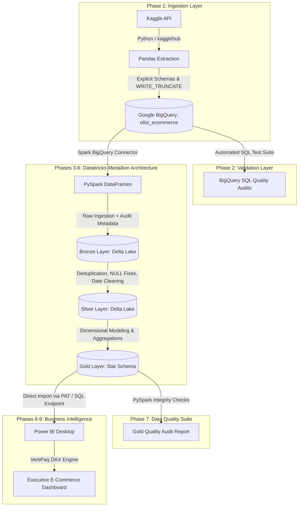

# End-to-End E-Commerce Data Engineering & BI Pipeline (Olist Brazilian E-Commerce)

[](https://www.python.org/)
[](https://cloud.google.com/bigquery)
[](https://databricks.com/)
[](https://spark.apache.org/)
[](https://powerbi.microsoft.com/)

An enterprise-grade, end-to-end Data Engineering pipeline and Business Intelligence solution built on the **Olist Brazilian E-Commerce Public Dataset from Kaggle** (~100k orders, 1M geolocation points). 

This project moves raw data programmatically from the Kaggle API into Google BigQuery, processes it through a Medallion Architecture (Bronze ➔ Silver ➔ Gold) in Databricks using PySpark and Delta Lake, models it into an analytics-ready Star Schema, and serves key performance metrics via Power BI.

---

## 1. End-to-End Architecture Diagram



---

## 2. Technology Stack

* **Language**: Python 3.12, PySpark (Apache Spark 3.4+), SQL, DAX
* **Cloud Data Warehouse**: Google Cloud Platform (GCP) BigQuery
* **Data Processing & Lakehouse**: Databricks, Delta Lake
* **Dataset**: Olist Brazilian E-Commerce Dataset (Kaggle)
* **BI & Visualization**: Microsoft Power BI Desktop
* **Libraries**: `google-cloud-bigquery`, `pandas`, `db-dtypes`, `pandas-gbq`, `kagglehub`, `python-dotenv`, `pyspark`

---

## 3. Project Directory Structure

```text
data_pipeline_bigqeury/
│
├── config/
│   └── config.py               # Dataset configuration & explicit BigQuery schemas
│
├── ingestion/
│   └── kaggle_to_bigquery.py   # Automated Kaggle fetch & BigQuery loader script
│
├── databricks/
│   ├── 00_bigquery_connector_setup.py   # Databricks Spark BigQuery setup
│   ├── 01_read_bigquery_tables.py       # PySpark BigQuery table reader
│   ├── bronze/
│   │   └── 01_ingest_to_bronze.py       # Bronze raw Delta tables builder
│   ├── silver/
│   │   └── 01_build_silver_layer.py     # Silver cleaned Delta tables builder
│   └── gold/
│       ├── 01_build_gold_layer.py       # Gold Star Schema Data Model builder
│       └── 02_gold_data_quality_checks.py # Gold Automated Data Quality Suite
│
├── sql/
│   ├── 01_row_counts.sql               # BigQuery table volume validation
│   ├── 02_null_checks.sql              # Mandatory PK/FK NULL audit
│   ├── 03_duplicate_pk_checks.sql      # Uniqueness validation
│   ├── 04_date_validations.sql         # Order lifecycle date consistency
│   ├── 05_numeric_validations.sql      # Price/freight non-negativity checks
│   ├── 06_order_status_distribution.sql# Order status breakdown
│   ├── 07_referential_integrity.sql    # Foreign key orphan check
│   └── run_validations.py              # Automated BigQuery SQL runner
│
├── dashboard/
│   ├── index.html                  # Bronze, Silver, Gold dashboard interface
│   ├── 01_power_bi_connection_guide.md # Databricks-to-Power BI setup guide
│   ├── 02_dax_measures.dax             # Production DAX measures library
│   └── 03_dashboard_design_specification.md # Visual UI/UX layout specs
│
├── .env.example                # Blueprint for local environment variables
├── .gitignore                  # Protects credentials, keys, zip/CSV files
├── requirements.txt            # Project dependencies
└── README.md                   # Enterprise documentation
```

### Local setup and execution

Run these commands from the repository root (Windows PowerShell):

```powershell
py -m venv .venv
.\.venv\Scripts\Activate.ps1
python -m pip install -r requirements.txt
Copy-Item .env.example .env
```

The scripts locate `.env` relative to the project files, so they do not depend on
the current working directory. Configure Kaggle authentication and Google Cloud
Application Default Credentials before running `python main.py`; ingestion and SQL
validation create or replace BigQuery resources. The Databricks transformation
phases require a Databricks runtime with the BigQuery connector and Delta Lake
configured. For local Spark execution, install a compatible Java runtime as well.

Open `dashboard/index.html` in a browser to switch between the Bronze, Silver, and
Gold dashboard views. Its figures are an illustrative preview, not live table
queries.

`extracting.py` downloads and previews `olist_orders_dataset.csv` by default. Set
`KAGGLE_FILE_NAME` to another CSV filename from the dataset to preview a different
table.

---

## 4. Phase Breakdown & Execution Details

### Phase 1 — Kaggle API to Google BigQuery
Programmatically authenticates with Kaggle via `kagglehub`, downloads raw datasets, enforces strong typing with explicit `google.cloud.bigquery.SchemaField` objects, and loads 9 tables into dataset `olist_ecommerce`:
* `customers` (99,441 rows)
* `geolocation` (1,000,163 rows)
* `order_items` (112,650 rows)
* `payments` (103,886 rows)
* `reviews` (99,224 rows)
* `orders` (99,441 rows)
* `products` (32,951 rows)
* `sellers` (3,095 rows)
* `product_category_translation` (71 rows)

### Phase 2 — BigQuery SQL Quality Audit
Executes 7 automated SQL checks verifying 100% row count fidelity, zero NULL primary keys, zero duplicate entity keys, 100% referential integrity, and uncovering a 166-record carrier delivery timestamp anomaly.

### Phase 3 — BigQuery to Databricks Integration
Establishes a direct Spark connection between Google BigQuery and Databricks using the Maven library `com.google.cloud.spark:spark-bigquery-with-dependencies_2.12:0.34.0` without intermediate local CSV downloads.

### Phase 4 — Bronze Layer (Delta Lake)
Persists raw tables in Databricks database `olist_bronze_db` using Delta Lake (`format("delta")`). Appends audit columns (`_ingested_at`, `_source_system`) to preserve original historical data. For the duplicate-removal demonstration, the Bronze order-items table also receives 100 tagged copies by default; set `BRONZE_DEMO_DUPLICATE_ROWS=0` to disable this demo behavior.

### Phase 5 — Silver Layer (Cleaned & Standardized)
Cleans and standardizes raw data into `olist_silver_db`:
* **`silver_orders`**: Deduplicates `order_id`, cleans carrier timestamp anomalies (`carrier_date < purchase_date`), calculates `delivery_time_days` and `is_delayed` flags.
* **`silver_customers`**: Standardizes cities (Title Case) and states (Uppercase).
* **`silver_products`**: Left joins translation table to add English category names, fixes column name typos (`product_name_length`), coalesces missing categories.
* **`silver_order_items`**: Deduplicates on `(order_id, order_item_id)`, removes the Bronze demo marker, filters negative prices/freight, and calculates `total_item_value = price + freight_value`.
* **`silver_reviews`**: Validates 1–5 score range, fills missing text with `'No comment'`.

### Phase 6 — Gold Layer & Data Modeling (Star Schema)
Models clean Silver tables into an analytics-ready Star Schema inside `olist_gold_db`:
* **Fact Table**: `fact_orders` (Grain: 1 row per order item). Measures: `quantity`, `price`, `freight_value`, `total_item_value`, `delivery_time_days`, `is_delayed`.
* **Dimension Tables**: `dim_customer`, `dim_product`, `dim_seller`, `dim_date` (generated 2016-2018 calendar), `dim_location`.

### Phase 7 — Automated Data Quality Suite
Runs 8 automated integrity checks on Gold tables, confirming 0 NULL PKs, 0 duplicate keys, 0 orphan foreign keys, and 0 negative price values.

### Phase 8 & 9 — Power BI Integration & Executive Dashboard
Connects Power BI Desktop directly to `olist_gold_db` via Databricks SQL Endpoint and Personal Access Token (PAT) using **Import Mode** (VertiPaq Engine).

#### Core DAX Measures Included:
* **Total Revenue**: `SUM(fact_orders[total_item_value])`
* **Total Orders**: `DISTINCTCOUNT(fact_orders[order_id])`
* **Average Order Value (AOV)**: `DIVIDE([Total Revenue], [Total Orders], 0)`
* **Average Delivery Time**: `AVERAGE(fact_orders[delivery_time_days])`
* **Delayed Orders %**: `DIVIDE(SUM(fact_orders[is_delayed]), [Total Orders], 0)`

---

## 5. Dashboard Visual Wireframe Placeholders

```text
+-----------------------------------------------------------------------------------+
|  [Date Range Slicer]  [Customer State]  [Product Category]  [Order Status Filter] |
+-----------------------------------------------------------------------------------+
|  TOTAL REVENUE   |   TOTAL ORDERS   |  TOTAL CUSTOMERS  |    AOV    | AVG DELIVERY |
|   $16.01M        |     99,441       |     99,441        |  $160.98  |  12.5 Days   |
+------------------+------------------+-------------------+-----------+--------------+
|  MONTHLY REVENUE & ORDER TREND      |  REVENUE BY PRODUCT CATEGORY                |
|  [Line & Stacked Column Chart]      |  [Horizontal Bar Chart]                     |
+-------------------------------------+---------------------------------------------+
|  TOP 10 SELLING PRODUCTS            |  DELIVERY TIME & DELAYED ORDERS             |
|  [Matrix / Table Visual]            |  [Gauge Chart / State Map]                  |
+-----------------------------------------------------------------------------------+
```

---

## 6. Engineering Challenges & Solutions

1. **PyArrow Float-to-Decimal Schema Mismatch**:
   - *Challenge*: `google-cloud-bigquery` PyArrow integration threw `ArrowInvalid` when loading pandas float series into BigQuery `NUMERIC` fields.
   - *Solution*: Aligned BigQuery schemas to `FLOAT64` for high-precision floating point prices, resolving PyArrow type conversion overhead.
2. **Data Anomaly (Carrier Delivery Timestamp < Purchase Timestamp)**:
   - *Challenge*: BigQuery Phase 2 validation discovered 166 records in the raw dataset where carrier delivery was recorded before order purchase.
   - *Solution*: Handled in Silver transformation using `when(carrier_date < purchase_date, None)` to protect downstream delivery latency metrics.
3. **Preventing Double-Counting in Multi-Item Orders**:
   - *Challenge*: Orders with multiple items share the same `order_id`. Summing order counts at item grain over-counts orders.
   - *Solution*: Established `fact_orders` grain at item level (`order_id_order_item_id`) and used `DISTINCTCOUNT(fact_orders[order_id])` for order counts in DAX.

---

## 7. Phase 10 Roadmap & Future Enhancements

- [ ] **Incremental Loading (CDC)**: Implement Delta Lake `MERGE INTO` upserts for incremental daily order ingestion.
- [ ] **Slowly Changing Dimensions (SCD Type 2)**: Track customer and seller location changes over time in `dim_customer` and `dim_seller`.
- [ ] **Pipeline Orchestration**: Automate end-to-end execution with Apache Airflow or Databricks Workflows.
- [ ] **CI/CD Automation**: Deploy GitHub Actions workflow to run automated PySpark unit tests and linting on pull requests.
